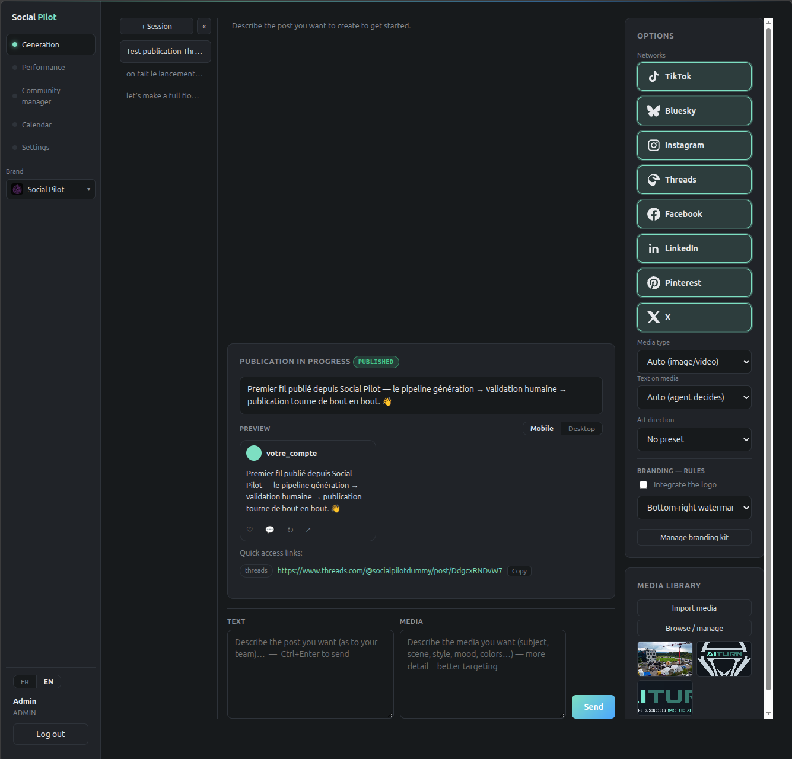
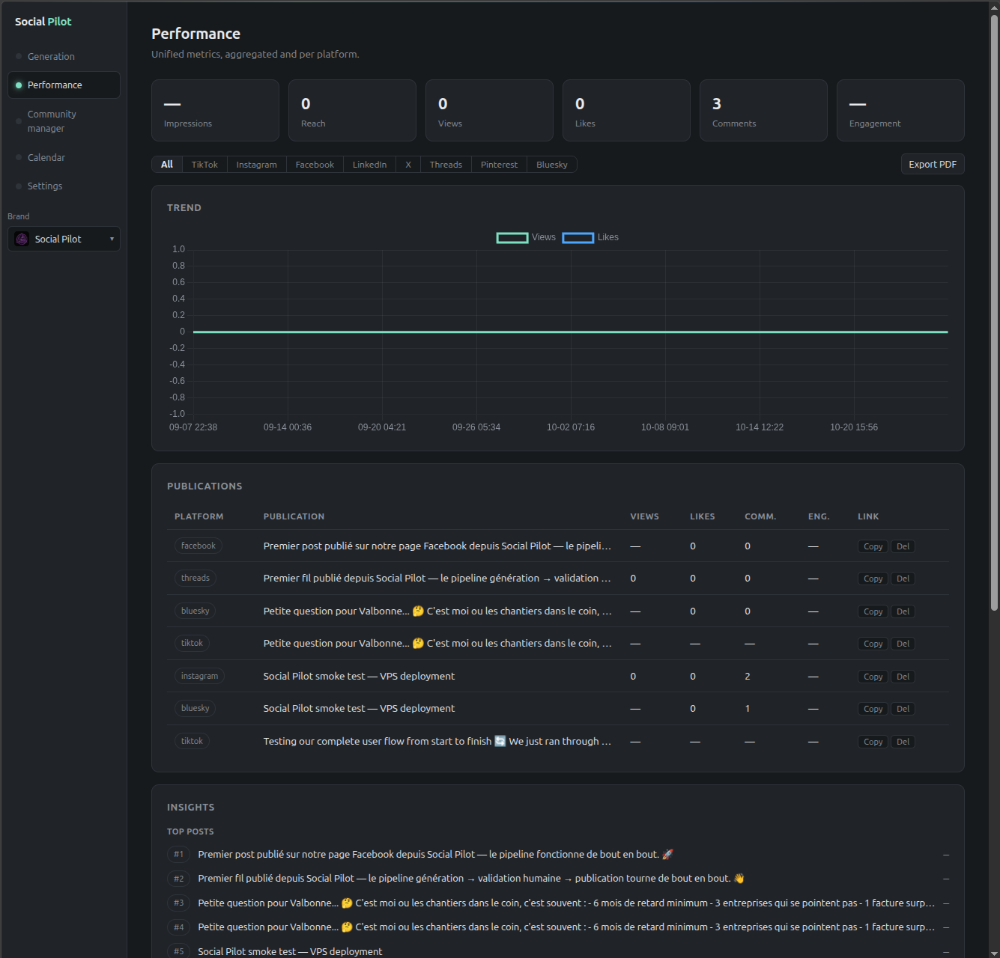
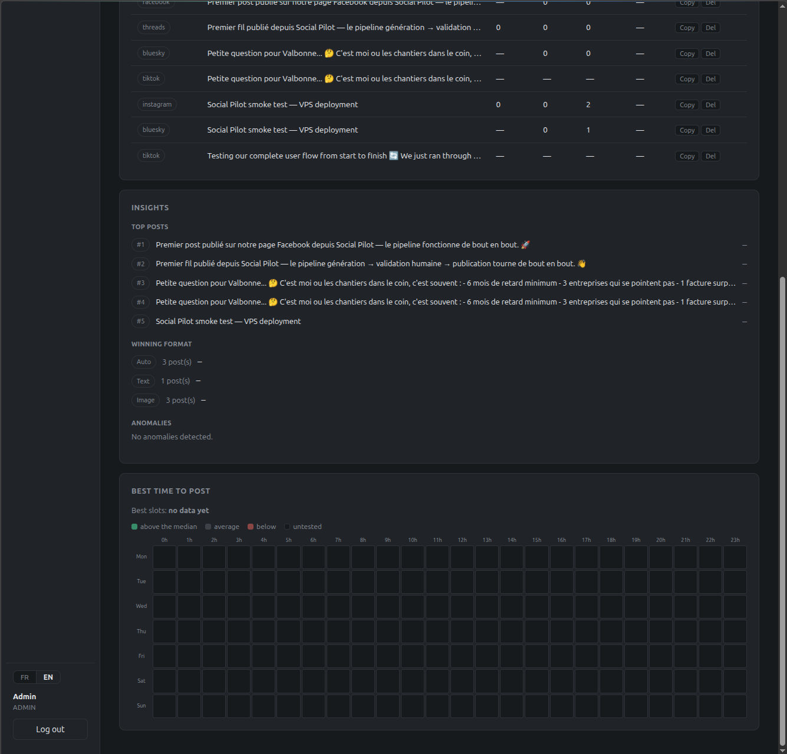
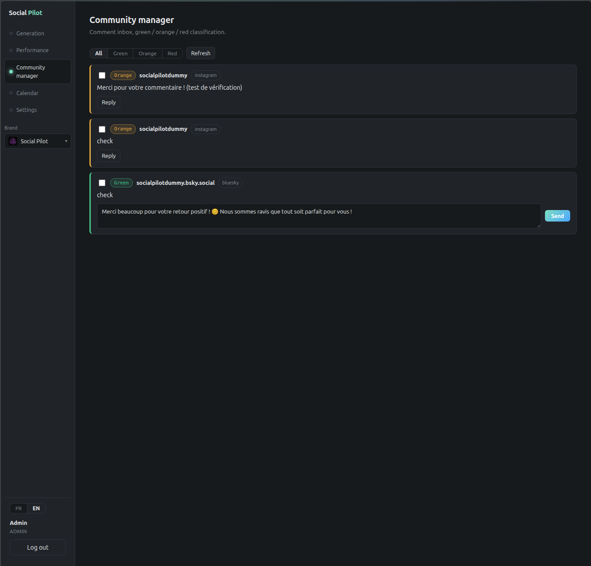

# La visite en images

Quatre écrans, une phrase chacun — les deux écrans de réglages restent à produire (§ final). Tout ce qui est affiché provient du **mode démo** : aucune donnée client,
aucun compte réseau réel, aucun appel de modèle. Les textes marqués `[démo]` sont produits localement.

---

## 1 · Génération

À gauche les sessions de travail, au centre la publication en cours (texte, aperçu mobile / desktop, lien vers
le post), à droite le choix des réseaux, le type de média, la direction artistique et le kit de marque.
**L'agent propose, l'humain valide** : rien ne se publie sans la double approbation visible à l'écran.

## 2 · Performance

Vues agrégées — impressions, portée, vues, likes, commentaires — avec la tendance et la liste des publications
par plateforme. En mode démo, les chiffres sont fabriqués localement, déterministes et croissants avec le temps :
le tableau de bord est vivant sans un seul appel d'API.

## 3 · Performance, détail

Classement des publications, anomalies détectées (aucune, ici), et grille « meilleur moment pour publier » —
vide tant qu'il n'y a pas d'historique réel, ce qui est la réponse honnête d'un système qui ne l'invente pas.

## 4 · Community manager

Boîte des commentaires, chaque message classé **vert** (positif), **orange** (question) ou **rouge** (plainte,
urgence, sujet sensible). La réponse proposée est un brouillon : elle n'est publiée qu'après validation humaine,
et le tri lui-même est un appel au modèle — en mode démo, une réponse déterministe et marquée `[démo]`.

## Les deux écrans de réglages — à refaire avant publication

Les captures des Réglages n'ont pas été publiées : elles contiennent un tableau d'utilisateurs, et rien ne permet
de garantir qu'aucune adresse réelle n'y figure. Le contrôle automatique refuse même de la transcrire — ce qui
n'est pas une preuve d'absence.

**Pour les produire proprement** : se connecter avec le compte de démonstration (`make demo` affiche ses
identifiants), aller dans les Réglages, capturer les deux écrans, puis les déposer en
`docs/screens/05-settings.png` et `docs/screens/06-settings-admin.png` et retirer cette section.

Ce que ces écrans montrent quand ils seront là : la langue, les marques, les réseaux connectés, la sécurité du
compte, le thème, la consommation mensuelle ; puis le fournisseur de modèle, sa clé, ses modèles par usage, le
plafond mensuel, la consommation ligne par ligne et la gestion des utilisateurs — avec `demo` affiché comme
fournisseur, sans clé et sans réseau.

---

### Ce que ces images ne montrent pas

Aucun écran n'expose une donnée client, une adresse d'infrastructure ou un identifiant. Les captures ont été
prises sur une instance de démonstration, avec des contenus eux-mêmes produits par le mode démo.
